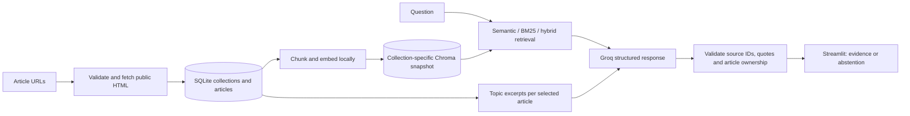

# News Research Workspace

[Open News Research Workspace](https://mynewsresearchtool.streamlit.app/). Choose **Try the demo** to search the sample articles without a key. Choose **Use my Groq key** to add your own news URLs, ask questions with citations, and compare coverage across two to four articles.

Hosted mode checks model access with Groq and keeps the key in server memory for the session. Each key opens its own collection directory. Disconnect clears the session. Streamlit Community Cloud storage may reset on redeploy. The hosted app runs MiniLM embeddings on the CPU using ONNX Runtime. Local private mode and the original benchmark use Sentence Transformers.

[Recruiter walkthrough](docs/walkthrough.md) | [Deployment guide](docs/deployment.md) | [Measured retrieval experiments](docs/retrieval-experiments.md)

## What the private workspace does

| Workflow | Behavior |
|---|---|
| Collect | Create named collections, ingest public HTML articles, reopen them after a restart, remove articles, and inspect processing errors. Normalized URLs and content hashes prevent duplicate records. |
| Retrieve | Search a collection with MiniLM semantic embeddings, BM25 keyword ranking, or reciprocal-rank fusion. The default retrieves four passages. |
| Ask | Generate structured claims through Groq. Every displayed claim links to a retrieved passage with a checked ID and verbatim quote. Invalid citations fail closed. |
| Compare | Select two to four reports. Compare a topic across them with per-article evidence, publication dates, and explicit missing-excerpt labels. |
| Inspect | Review source text, generation latency, token usage, per-question retrieval rankings, evaluation labels, and known limitations. |



SQLite is the canonical data store; vectors can be rebuilt. Changing article content changes the index revision. Collections isolate topics in a single-owner workspace. They are not tenant accounts. [Storage design](docs/collections.md) · [Evidence validation](docs/evidence.md) · [Comparison design](docs/comparison.md)

## Setup

From this checkout on Windows PowerShell:

```powershell
py -3.12 -m venv .venv
.\.venv\Scripts\python.exe -m pip install -r requirements.txt
.\.venv\Scripts\python.exe -m streamlit run main.py
```

On macOS/Linux, use `python3.12 -m venv .venv` and `.venv/bin/python` in place of `.\.venv\Scripts\python.exe`. The default hosted mode accepts your own key. Set NEWS_RESEARCH_MODE=demo to use only the bundled synthetic articles.

For **private mode**, install `requirements-private.txt` instead, copy `.env.example` to `.env`, and configure:

```dotenv
NEWS_RESEARCH_MODE=private
APP_PASSWORD=choose-a-long-unique-workspace-password
GROQ_API_KEY=your-own-key
GROQ_FREE_TIER_CONFIRMED=false
```

Check the key's account plan yourself before setting `GROQ_FREE_TIER_CONFIRMED=true`. This is an owner assertion, **not a provider billing check or spending cap**. Leave it false to prevent live generation. The app never upgrades plans or retries a failed model request automatically. Article management can be used without live generation. Do not commit secrets. No Hugging Face token is required; the public MiniLM model downloads on first use. The actual Groq model is `openai/gpt-oss-20b`.

Private mode is designed for a trusted owner with a durable `NEWS_RESEARCH_DATA_DIR`. For hosting, enable access controls at the hosting provider too; a shared password is not multi-user authentication.

## Evaluation results

The repository includes **8 authored synthetic articles and 44 labeled questions**. The split is 30 dev questions and 14 held out, including eight unanswerable questions across both splits. The test set includes ten answerable questions. Unanswerable cases are excluded from retrieval relevance metrics, not counted as correct abstentions.

| Held-out retrieval | Precision | Recall | MRR | All required evidence found |
|---|---:|---:|---:|---:|
| Semantic @2 | 0.55 | 0.95 | 0.95 | 0.90 |
| **Semantic @4 (default)** | **0.30** | **1.00** | **0.95** | **1.00** |
| BM25 @4 | 0.30 | 1.00 | 1.00 | 1.00 |
| Hybrid @4 | 0.30 | 1.00 | 0.95 | 1.00 |

The fixture is small and favors exact names and numbers. These results do not establish production accuracy or live model quality. Semantic @2 missed part of one multi-article answer; hybrid did not beat semantic recall at k=4. We retained the original default and exposed alternatives for future evaluation.

```sh
python -m unittest discover -s tests -v
python -m evaluation.run --split dev
python -m evaluation.compare --split dev
python -m evaluation.compare --split test
```

Use private dependencies for the full suite and evaluations. CI checks hosted sign-in, workspace isolation and the optional demo with the deployment dependencies. Unit and integration tests use controlled model responses, real local Chroma storage, and Streamlit interaction tests. The measured retrieval benchmark uses real local embeddings. No CI secrets, model downloads, or Groq requests are required by the tests. [Evaluation protocol](evaluation/README.md) · [Per-question reports](evaluation/results/)

## Practical limits

- A real citation can still be misinterpreted. Exact quote checks do not verify semantic entailment, and no confidence percentage is shown.
- Comparison uses excerpts, not exhaustive full-article analysis. Differing reports may reflect dates or definitions rather than contradictions.
- The fetcher pins connections to validated public IPs, checks each redirect, keeps TLS hostname verification, limits response size and timeouts, and accepts HTML only. Paywalls, JavaScript-only pages, and publishers that reject automated requests may not work. Use trusted articles and deployment-level egress restrictions as defense in depth.
- Extracted text is capped at 15,000 characters; short lines are dropped. Up to 50 article records are allowed per collection. SQLite and local Chroma are suitable for small workspaces, not distributed multi-user operation.
- Local files on ephemeral hosting are not a durability guarantee. The public demo needs no persistent disk. The MVP's old unscoped index is not imported automatically.
- Live citation support, live abstention rates, and production latency remain unmeasured. A larger independently annotated news corpus is the next useful evaluation investment.
